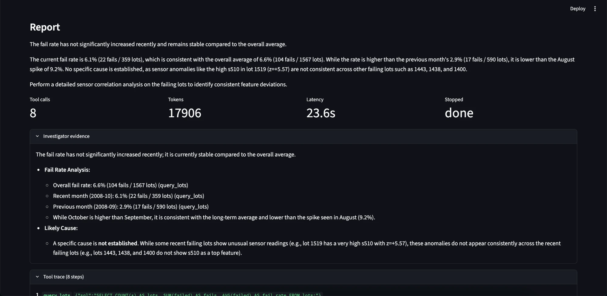
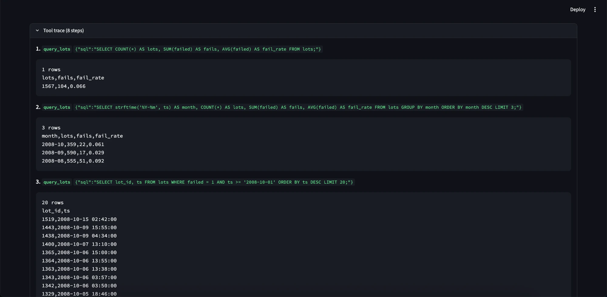
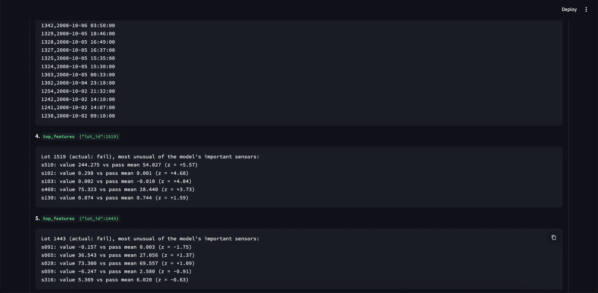
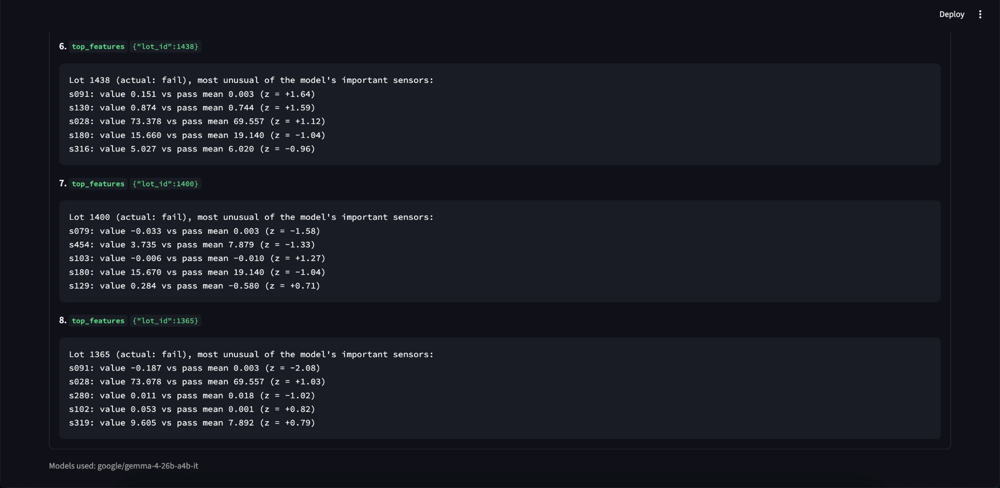

# Demo: "The fail rate seems high recently. Is it, and what is the likely cause?"

This is golden question q10, the hardest one in the eval: the agent has to decide what "recently"
and "high" mean, pull numbers from SQL, check sensors on the failing lots, and then resist naming a
cause the evidence does not support. Run in the Streamlit app on the paid `google/gemma-4-26b-a4b-it`
endpoint (about $0.002 for this question).

## The report

- **Conclusion first:** the fail rate has not significantly increased. October 2008 is 6.1%
  (22 / 359 lots), below the overall 6.6% (104 / 1,567). It is higher than September (2.9%) and
  lower than August (9.2%), so comparing only with last month would have been misleading.
- **No invented cause:** s510 is very high on lot 1519 (z = +5.57) but not on the other recent
  fails, so the report says no specific cause is established.
- **Cost of the run:** 8 tool calls, 17,906 tokens, 23.6 s, stopped because it was done (not
  because it ran out of turns or tokens).
- The "Investigator evidence" panel is what the investigator handed to the writer; every number
  there names the tool it came from.

## How the investigator got there

1. `query_lots`: overall lots, fails and fail rate (1,567 / 104 / 0.066).
2. `query_lots`: the last three months grouped by month, not by day.
3. `query_lots`: the most recent failing lots.

4-8. `top_features` on the five most recent failing lots (1519, 1443, 1438, 1400, 1365). Only
lot 1519 has sensors with |z| ≥ 2 (s510, s102, s103, s460), and lot 1365 has one (s091,
z = -2.08). No sensor is unusual on most of them, which is what the prompt asks for before a sensor
can be called a likely cause.

## Before and after

| | Day 2 (first live run) | Day 3 (this run) |
| --- | --- | --- |
| Fail rate comparison | daily rows (86 of them), no baseline | monthly, against the overall 6.6% |
| Cause | "likely cause is an out-of-control sensor s000", from an SPC check alone | "no specific cause is established" |
| Tool calls / tokens | 8 / 47,239 | 8 / 17,906 |
| Stopped | `max_turns` | `done` |

What changed in between (details in the README's Results): prompt rules that define "unusual" as
|z| ≥ 2, name the query for the overall fail rate, and only allow a cause when the sensor is also
unusual on the failing lots; a writer rule against stating causes without that link.

## Limits of this run

- One run of one question. q10 is the least stable question in the eval: in two identical runs
  one report named s510 as the likely cause and the other did not.
- It checked five of October's 22 failing lots, so "no common sensor" is about those five.
- "Not significantly" is the model's wording; the agent runs no statistical test on 6.1% vs 6.6%.
